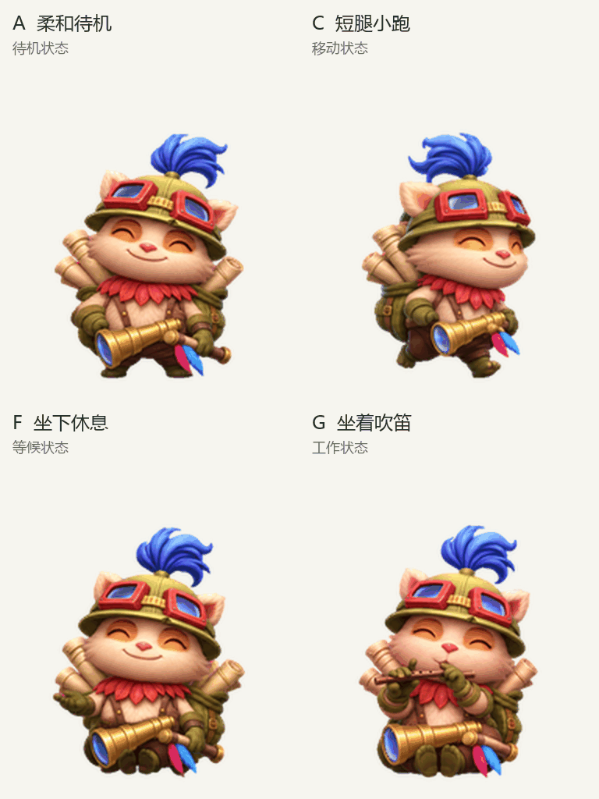

# 提莫探险家 · Teemo Pet

圆脸、短腿的提莫宠物，包含 9 组动作和 16 个视线方向。本版采用原图微笑作为默认姿势，并加入 A、C、F、G 四种动作。

## 直接领养

**[点击领养这只提莫](https://chatgpt.com/s/sharepet_6af29fbfffb48191b520f317e8bdcc3b)**

在支持 Pets 的 ChatGPT Work 环境打开链接，按页面提示添加到自己的宠物库，再选为当前宠物。也可以将链接发给已连接 Pets 的助手，请它“领养并选中这只提莫”。

## 动作预览

| 动作 | 表现 | 触发状态 |
| --- | --- | --- |
| A | 呼吸、轻微重心变化和耳羽跟随 | 待机 |
| C | 短腿小步交替，身体轻微起伏 | 左右移动 |
| F | 坐下休息，吹箭筒横放腿上 | 等候输入 |
| G | 坐着吹木笛，手指和身体轻微随动 | 工作 |

动作由宠物当前状态触发。

- [全部动作 GIF](previews/all-states.gif)
- [全部动作 MP4](previews/all-states.mp4)
- [16 个视线方向](previews/look-loop.gif)
- [动作静帧](previews/motion-stills.png)

## 下载与图集规格

下载 [透明 PNG 图集](assets/teemo-v2.png) 和 [图集配置](manifest.json)，可按行列读取每个 192 × 208 像素的动画帧。

| 项目 | 数值 |
| --- | --- |
| 格式 | PNG，RGBA 透明背景 |
| 图集版本 | v2 |
| 完整尺寸 | 1536 × 2288 |
| 布局 | 8 列 × 11 行 |
| 单帧尺寸 | 192 × 208 |
| 已用帧 | 73 |
| 透明空格 | 15 |

| 行号 | 状态 | 帧数 |
| --- | --- | --- |
| 0 | idle · 柔和待机 | 6 |
| 1 | running-right · 向右小跑 | 8 |
| 2 | running-left · 向左小跑 | 8 |
| 3 | waving · 挥手 | 4 |
| 4 | jumping · 跳跃 | 5 |
| 5 | failed · 受挫 | 8 |
| 6 | waiting · 坐姿等候 | 6 |
| 7 | running · 坐着吹笛工作 | 6 |
| 8 | review · 检查 | 6 |
| 9 | 顺时针视线 0° 至 157.5° | 8 |
| 10 | 顺时针视线 180° 至 337.5° | 8 |

视线从上方的 0° 开始，顺时针每 22.5° 一帧。90° 朝画面右侧，180° 朝下，270° 朝画面左侧。默认静态帧位于第 0 行、第 0 列。

[SHA256 校验值](SHA256SUMS) 对应公开的 PNG 图集。

## 制作与角色来源

本项目使用 AI 图像重绘与动画帧生成，并经过图集结构、透明背景、动作和视线检查。部分相邻斜向视线的变化较细微。

提莫角色来自《英雄联盟》，相关角色及品牌权利归 Riot Games 所有。本项目为粉丝制作的宠物分享资源。
